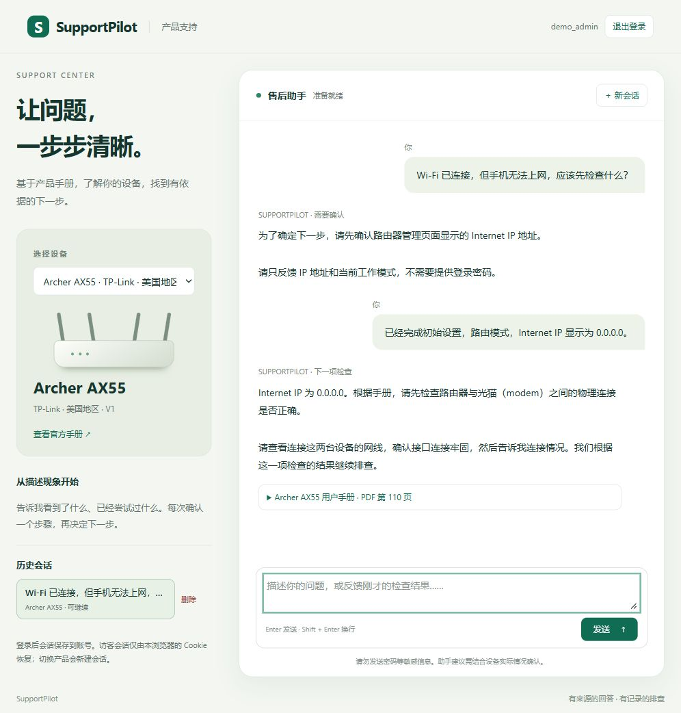
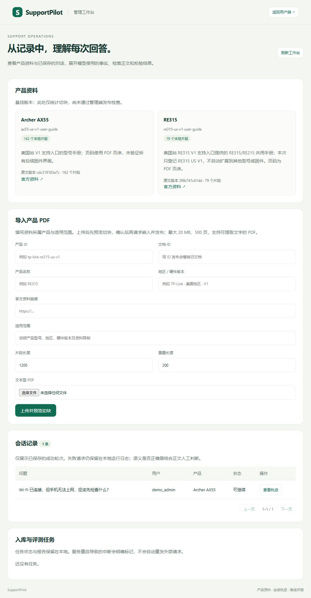
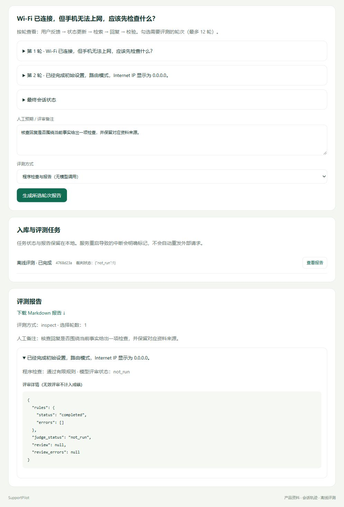
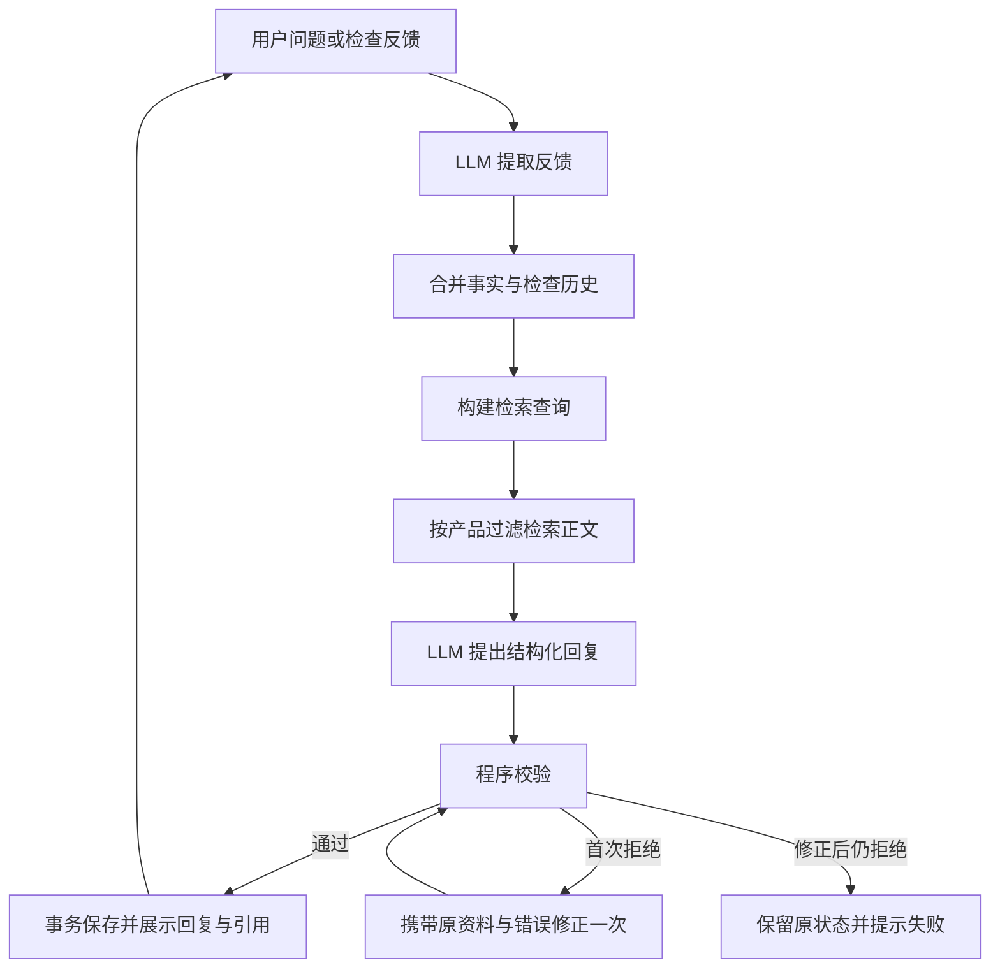

# SupportPilot

**基于产品文档的售后问答与交互排障 Agent。**

SupportPilot 面向企业官网的产品支持场景：用户选择设备并描述问题，Agent 结合官方资料、会话事实和检查历史，给出有来源的回答、追问或下一项检查。管理员可以导入产品 PDF、发布知识库版本，并从会话轨迹中选择回复进行评测。

新增产品通过文档与产品元数据接入，排障建议由模型阅读资料后决定。示例产品包含 **TP-Link Archer AX55 US V1** 与 **RE315 US V1**，共享对话、检索和评测逻辑。

## 功能概览

| 用户端 | 管理端 |
| --- | --- |
| 产品选择、资料问答与多轮排障 | 文本型 PDF 上传与分页切块预览 |
| 引用正文、PDF 页码与来源链接 | 索引完整性检查与知识库版本发布 |
| 事实纠正、检查反馈、恢复或交接摘要 | 产品资料清单与会话轨迹查看 |
| 临时身份、注册登录、历史恢复和会话删除 | 选择会话轮次、程序检查与可选模型评审 |
| 服务重启后恢复已保存会话 | 任务状态、评测结果及 Markdown 报告 |

## 界面预览

截图来自当前应用的独立演示环境，账号与对话为合成数据，回复使用固定演示内容；用于展示交互流程，不代表模型效果评测结果。

**客户端 · 多轮排障与来源引用**

选择产品、补充设备状态，并根据带手册页码的建议逐步排查；历史会话保留在侧栏。



**管理端 · 产品资料与文档接入**

查看产品资料与切块概览，通过 PDF 导入入口准备新资料，并查看已保存的会话。



<details>
<summary>展开查看管理端的会话评测与报告</summary>

选择会话轮次、填写评审备注并生成报告。图中采用不调用模型的程序检查模式，模型评审状态明确标为 `not_run`。



</details>

## Agent 如何工作



LangGraph 编排反馈提取、合并、检索、生成和校验，并在候选被拒绝时执行一次有界修正。模型选择 `answer`、`ask_user`、`recommend_check`、`resolved` 或 `handoff`；会话 State 保存事实、检查记录、待答项和消息。

Python 校验输出格式、引用 ID、产品归属与明确重复；正文支持、操作前提和语义重复需要结合模型评审与人工审阅。超时、合并异常或再次校验失败时，候选不会提交为已接受会话。

## 设计重点

- **资料驱动的多产品接入**：保留正文、来源、产品与版本信息，无需按型号配置故障树或操作目录。检索使用产品过滤，命中片段可补充同文档前一块，减少条件被切断的情况。
- **候选与会话状态分离**：只有通过校验的轮次才将消息、State 和引用正文一起提交到 SQLite。会话归属与并发版本检查由服务端执行。
- **发布前构建新索引**：完整语料快照映射到独立 Chroma 集合，核对片段 ID 和数量后切换在线版本。失败保留旧版；已开始的轮次继续使用持有的检索快照。
- **可回放、可审阅的轨迹**：保存反馈、状态、查询、正文、回复、校验和修正记录。评测固定原输入与候选，分别记录程序检查、模型判断、错误和无效评审，便于定位问题。

## 技术栈

Python · Pydantic · LangChain 模型接口 · LangGraph · Chroma · FastAPI · SQLite · bcrypt · 原生 HTML/CSS/JavaScript。

聊天客户端使用百炼的 OpenAI 兼容接口，运行配置集中在 [config.py](supportpilot/config.py)，客户端创建位于 [providers/bailian.py](supportpilot/providers/bailian.py)。聊天与嵌入的地址、密钥和模型通过环境变量配置，模板见 [.env.example](.env.example)。

## 快速运行

使用标准 CPython 3.12，在仓库根目录创建虚拟环境：

```powershell
python -m venv .venv
.\.venv\Scripts\Activate.ps1
python -m pip install -r requirements.txt
if (-not (Test-Path .env)) { Copy-Item .env.example .env }
```

在 `.env` 填写聊天服务密钥和嵌入服务配置。两者可以使用不同密钥；模型可用性与嵌入地址需匹配服务账号。依赖清单固定直接依赖版本，传递依赖未完全锁定。

```powershell
python -m uvicorn supportpilot.server.api:app --host 127.0.0.1 --port 8000
```

打开 [用户端](http://127.0.0.1:8000)。页面浏览与注册不调用模型，发送消息需要已发布或已入库的产品资料。

### 接入产品资料

仓库包含来源清单与合成案例，原始 PDF、向量索引和会话数据由运行环境保存。首次使用可以通过管理端导入：

1. 在用户端注册账号，然后停止服务。
2. 设置已注册用户名并重新启动：

   ```powershell
   $env:SUPPORTPILOT_ADMIN_USERS = "你的已注册用户名"
   python -m uvicorn supportpilot.server.api:app --host 127.0.0.1 --port 8000
   ```

3. 登录后打开 [管理端](http://127.0.0.1:8000/admin)，填写产品与来源信息，上传官方文本 PDF。
4. 预览片段，确认外部调用后执行入库发布。用户端刷新后选择产品开始对话。

示例资料可从 [AX55 用户手册](https://www.tp-link.com/us/document/79681/) 和 [RE315 用户手册](https://www.tp-link.com/us/document/76068/) 获取。RE315 手册同时涉及 RE215，产品目录仅登记 RE315 US V1。基线语料也可使用 [多产品 CLI](examples/rag/GENERALIZATION.md) 准备。

上传与预览只在本地解析。入库会调用嵌入服务，完整新语料可能包含保留文档的重新嵌入；模型评审会发送所选轮次的对话与检索正文。两项操作均要求页面显式确认。

## 评测与复现

无需服务密钥即可运行合成记录的规则检查与报告：

```powershell
python -m supportpilot.cli.eval_demo --record examples/evaluation/synthetic-replay.json
python -m unittest discover -s tests
```

模型评审使用正文支持、操作前提和会话历史三项标准。结果保留 `pass / fail / unclear / not_applicable`，前提项附必要条件、已确认事实与缺项审计；缺失或自相矛盾的审计标记为 `invalid_review`。程序检查通过不作为模型质量成绩，合成案例也不作为真实设备解决率。

测试覆盖状态合并、产品隔离、图修正、事务一致性、身份与权限、资料发布、评测快照和错误处理。模型与嵌入调用在测试中使用替代实现；真实召回和建议质量需以实际运行记录评估。

可选接入 Ragas，对保存的回复计算 Faithfulness 与 Context Utilization；CLI 使用 `--ragas`，管理端选择对应评测方式。评分复用已有快照并单独记录数值、缺失、不适用和错误，使用实际生成上下文（含前文补块），不作为原始检索排名或排障成功率。安装与使用见 [Ragas 指标说明](examples/evaluation/README.md#ragas-指标)。

| 复现入口 | 用途 |
| --- | --- |
| [给定资料回复](examples/grounded/README.md) | 固定正文下观察模型行为 |
| [单文档 RAG](examples/rag/README.md) | 提取、切块、入库和召回 |
| [反馈与多轮](examples/conversation/README.md) | 事实纠正、检查反馈与终端对话 |
| [图与候选修正](examples/graph/README.md) | 记录回放和单轮重新执行 |
| [离线评测](examples/evaluation/README.md) | 规则检查、语义评审和报告 |
| [Web 与账号](examples/web/README.md) | 用户端运行与会话恢复 |
| [管理端](examples/web/ADMIN.md) | 资料发布与轮次评测 |

## 代码结构

```text
supportpilot/
├── agent/         # 反馈、回复、编排与候选修正
├── knowledge/     # 文档、嵌入与检索
├── evaluation/    # 轨迹、评审与报告
├── storage/       # SQLite 会话与账号数据
├── auth/          # 密码哈希
├── providers/     # 模型客户端
├── server/        # API、管理功能及 static/ 页面
├── cli/           # 实验与复现命令
└── legacy/        # 历史固定分支实现
examples/          # 来源配置与合成案例
tests/             # 离线回归
```

函数入口与模块职责见 [代码导航](supportpilot/README.md)。

## 适用范围与取舍

项目采用单机单进程运行、文本型 PDF 解析和完整语料快照发布，适合展示资料接入、Agent 对话、状态提交和离线评测的闭环。模型评审存在审计缺失和判断不稳定的情况，报告保留这些失败，关键建议仍需人工核对。

`handoff` 生成沟通摘要，真实工单系统和设备控制尚未接入。OCR、资料删除与回滚界面、经验库和 Langfuse 属于扩展方向。项目是独立实现，与设备厂商的官方售后服务无关联。

运行记录、上传资料、评测快照和密钥留在 Git 忽略目录。删除会话不会删除此前独立选入评测的快照。
